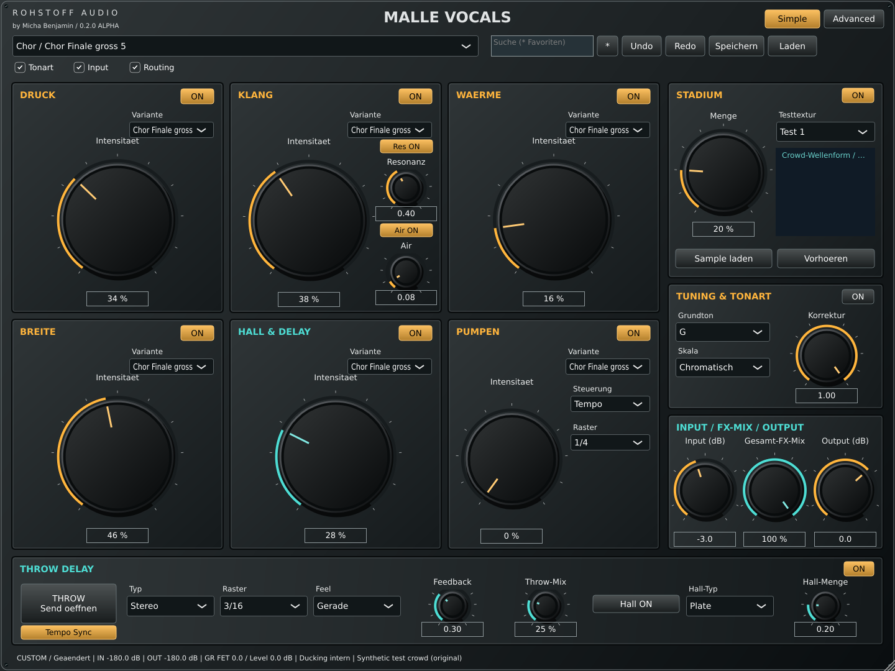
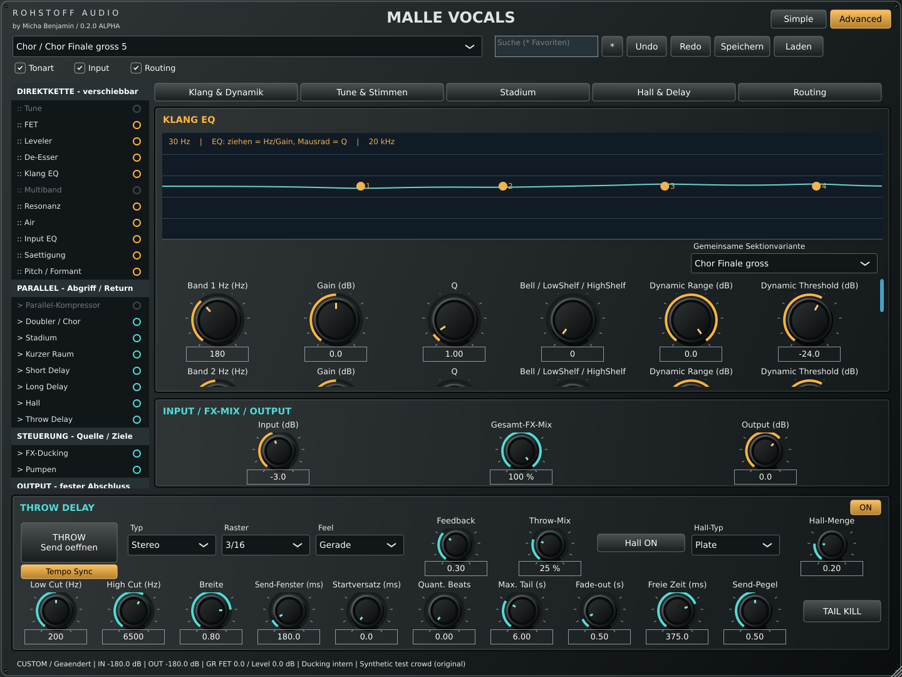

# Malle Vocals 0.2.0 Alpha — reale Prüfungen und Downloads

Stand: 15.10.2026. Gebauter Quellcode-Commit: `0213b38d07ed664035b776af1dbb8062b8049dc8`.
Der Gesamtauftrag ist weiterhin in Entwicklung. Keine Verkaufsfreigabe, keine behauptete Künstlerrekonstruktion.

## Native Builds

| Paket | Tatsächlicher Befund | Download |
|---|---|---|
| Windows | x64 VST3 + Standalone, CI Build und alle drei CTest-Suites erfolgreich; PE-Machine 0x8664 zusätzlich aus dem Paket geprüft | [Windows-Artefakt](https://github.com/DerMichaBenjamin/MalleVocalsVST/actions/runs/38673300202/artifacts/11945367517) |
| macOS | Universal VST3 + AU + Standalone; CI auf Sonoma 14.8.9; alle drei CTest-Suites erfolgreich. Mach-O-FAT-Header aller drei Binärdateien enthält x86_64 und arm64. CI-Codesign-Prüfung erfolgreich, ausschließlich ad hoc | [Mac-Artefakt](https://github.com/DerMichaBenjamin/MalleVocalsVST/actions/runs/38673300202/artifacts/11945685065) |
| Linux | x86_64 VST3 + Standalone lokal gebaut; alle drei CTest-Suites und zusätzliche unabhängige VST3-Validierung erfolgreich | reproduzierbar aus Quellcode |

[Erfolgreicher vollständiger Workflow](https://github.com/DerMichaBenjamin/MalleVocalsVST/actions/runs/38673300202). SHA256-Dateien liegen in den Paketen. CI-Artefakte haben 30 Tage Aufbewahrung. README beschreibt Installation und Build.

Mac ist noch nicht Developer-ID-signiert oder notarisiert; Windows ist nicht Authenticode-signiert. Vorbereitete Skripte verwenden vorhandene lokale Zertifikate/Keychain-Profile, keine Zugangsdaten im Chat. Exakt Sonoma 14.5 sowie Cubase, REAPER, Ableton Live, FL Studio, Studio One, Bitwig und Logic Pro wurden hier nicht im tatsächlichen Host getestet. Der Universal-Build bedeutet nicht, dass beide CPU-Architekturen getrennte reale DAW-Tests erhalten hätten.

## Bestandene lokale Prüfungen

- `DSP`: 100 globale Presets, 20 kompatible Varianten-IDs, endliche/beschränkte Ausgaben; 44,1/48/96 kHz, Mono/Stereo, Puffer 1/64/257/1024; latenzausgerichteter Bypass, Pitch-Erkennung, keine C++-Heap-Allokation im geprüften DSP-Pfad, Detail-Bypass maßgeblich.
- `PluginStateAndUI`: tatsächliches Laden aller 100 globalen Presets und Vergleich aller Detailparameter, Locks, Undo/Redo, wirksame Routingänderungen mit Recall, De-Esser-Presets, identischer Zustand beim Ansichtswechsel, eingebettetes Sample nach Löschen der ursprünglichen Datei, exakter Offline-Recall und gerenderte Simple-/Advanced-Oberflächen.
- `MeasuredDSP`: Oktav-Pitch, monophones Hard-Tune, dynamische Resonanzabsenkung, Air-Anhebung, externe Sidechain-Kompression, hörwirksame Direktmodulreihenfolge anhand verschiedener Ausgangspegel; Throw-Latenz/Fenster/Fahne, Ping-Pong-Kanalfolge, Send-Schließen beim Loslassen und eigener Tail-Kill.
- [CTest-Protokoll](validation/ctest-linux-0.2.0.log).

## Unabhängige VST3-Validierung

[Tracktion pluginval](https://github.com/Tracktion/pluginval), offizielle Linux-Binärversion 1.0.4, Strictness 5, Seed 42, vollständige Prüfung einschließlich GUI: **SUCCESS, Exit 0**. Die vollständige Logdatei ist [hier](validation/pluginval-linux-0.2.0.log). Enthalten sind Plugin-Laden, Editor, Prozessvarianten, Automation/State sowie Buskonfigurationen bei 44,1/48/96 kHz und Puffern 64/128/256/512/1024. Das ist ein Validatorlauf auf Linux, kein Test in Cubase oder einem anderen genannten DAW-Host.

Reproduktion mit installiertem pluginval:

```sh
pluginval --strictness-level 5 --random-seed 42 --timeout-ms 120000 --validate 'build/MalleVocals_artefacts/Release/VST3/Malle Vocals.vst3'
```

Für GUI-Prüfungen ist eine erreichbare Anzeige erforderlich. In der isolierten Entwicklungsumgebung wurden Xvfb und pluginval innerhalb desselben Aufrufumfelds gestartet. Der erste Versuch mit einer aus einem anderen isolierten Aufruf stammenden Anzeige brach in pluginvals XEmbed-GUI ab; nach Korrektur der Anzeigeumgebung bestand derselbe unveränderte Pluginbuild die vollständige Prüfung. Die Audio-/State-Prüfung mit `--skip-gui-tests` bestand ebenfalls. Kein Pluginfehler wurde dafür als angeblich behoben ausgegeben.

## Tatsächliche Audioanalyse / Grenzen

42 unterschiedliche Audio-Previews für 15 Acts gemessen; 43 Katalogzuordnungen. Mittige 8-s-Ausschnitte des Masters und kombinierte Demucs-Vocal-Schätzungen. 45 experimentelle Rollenadaptionen eingebunden, zusätzlich 55 technische Ausgangspresets. [Zuordnung, Daten, Versionen, Zeitfenster, Auswahlbelege und offene Referenzen](SONG_REFERENCE_ANALYSIS.md).

70 tatsächliche Offline-Render der Studien auf Vocal-Schätzmaterial, inklusive veränderter Eingangspegel und identischer Eingangsdatei für alle 15 Main-Studien: vollständig endliche Ausgaben, kein Peak über 0 dBFS (Maximum −13,32 dBFS), größter Mono-Fold-RMS-Verlust 2,33 dB. Alle 15 Main-Studien erzeugen auf identischem Eingang unterschiedliche RMS-normalisierte Spektralmerkmale. Numerische Verschiedenheit beweist keine musikalische Brauchbarkeit. RMS-Abgleich ist keine wahrnehmungsbasierte Lautheits-/Hörabnahme.

Keine subjektive Höranalyse, keine gesicherte getrennte Analyse von Main/Backing/Crowd, keine Strophe-/Refrain-Zuordnung und keine professionelle Preset-Hörabnahme behauptet. Keine urheberrechtlich geschützten Referenzaufnahmen im Repository oder Plugin. Für diese offenen Schritte fehlen eindeutig zugeordnete Vollsongabschnitte/Rollenstems und trockene verschiedene Stimmen. Crowd-ZIP war nicht verfügbar. Weitere technische Lücken stehen in [STATUS](STATUS.md).

## Native Screenshots

Diese Bilder wurden aus dem tatsächlich gebauten Editor gerendert, nicht aus einem HTML- oder Bildmockup:




