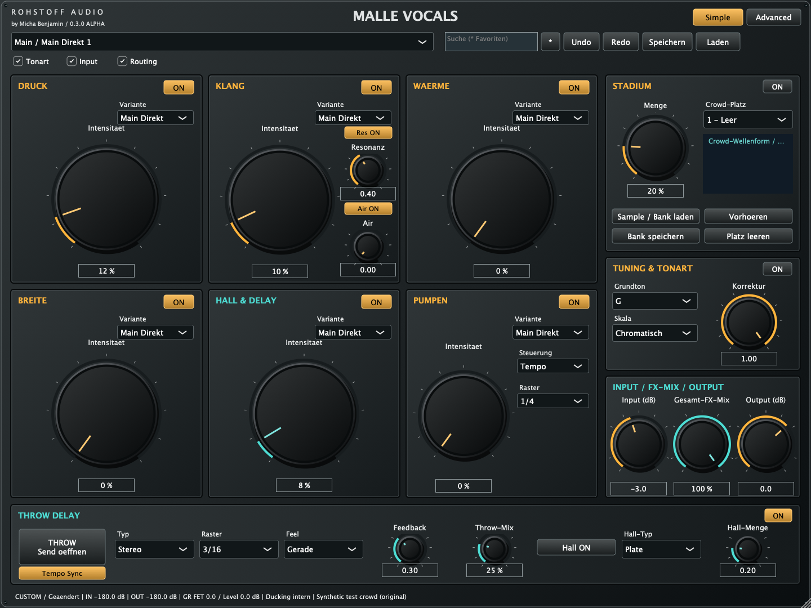
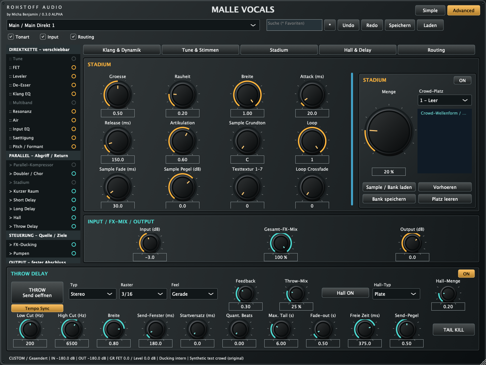
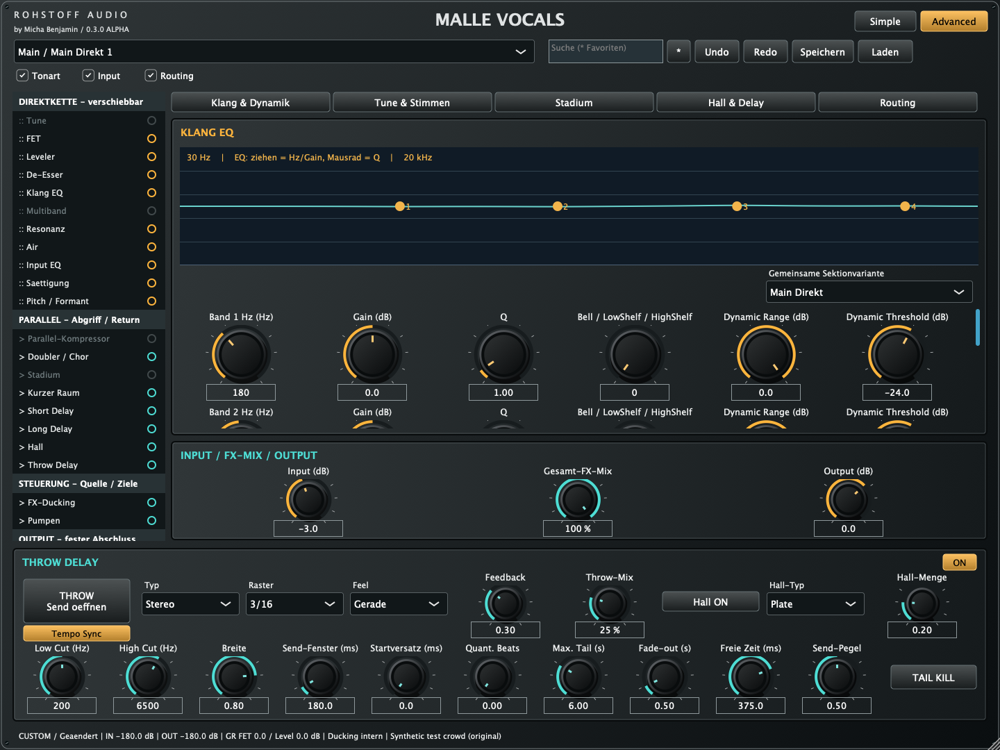

# Malle Vocals 0.3.0 Alpha — 16.10.2026

Gebauter und getesteter Code: `28e6064f4a7307317b176666ba3c447cf33bd341`.
[Erfolgreicher CI-Lauf mit beiden Plattformen](https://github.com/DerMichaBenjamin/MalleVocalsVST/actions/runs/38911281676).

| Plattform | Tatsächlich geprüft | Paket |
|---|---|---|
| Windows x64 | VST3 + Standalone gebaut; alle vier CTest-Suites bestanden; PE-Machine 0x8664 und ZIP-Prüfsumme nach Download überprüft | [Windows](https://github.com/DerMichaBenjamin/MalleVocalsVST/actions/runs/38911281676/artifacts/12050547293) |
| macOS Universal | VST3 + AU + Standalone gebaut; alle vier CTest-Suites auf Sonoma 14.8.9 bestanden; ad-hoc Codesign validiert; Intel/Apple-Silicon-Mach-O-Header aller drei Binärdateien und ZIP-Prüfsumme nach Download geprüft | [macOS](https://github.com/DerMichaBenjamin/MalleVocalsVST/actions/runs/38911281676/artifacts/12050691955) |
| Linux Core | unabhängige Audioengine gebaut; DSP, MeasuredDSP und CrowdBankDSP bestanden; zusätzliche echte Crowd-Dateien offline verarbeitet | Quellcode / Messprotokoll |

Native CTest-Suites: DSP / PluginStateAndUI / MeasuredDSP / CrowdBankDSP. Geprüft werden weiterhin alle 100 globalen Presets, 44,1/48/96 kHz, Mono/Stereo, verschiedene Puffer, State/Locks, Undo/Redo und bisherige Pitch-/Dynamik-/Throw-Funktionen. Neu: sieben Carrierplätze, tatsächliche Audioauswahl durch Automation, Slot- und Loopüberblendung, Bank-Export/-Import einschließlich Standard-Base64, individuelle Samplewerte, Clear/Undo/Redo, alte Sample-Presets und in Advanced erreichbare Bankbedienung. Factorypresets erhalten Sample-Metadaten; der Routing-Lock erhält die echte Direktmodulreihenfolge.

Bei der Verarbeitung der tatsächlichen fünf vorbereiteten Crowd-Dateien blieben beide getesteten Modi endlich und ohne digitale Übersteuerung. Während der geprüften Parameter-/Prozessschleifen wurden null C++-Heap-Allokationen gezählt. Verfahren, Einstellungen, Lautheitsunterschiede und exakte Zahlen: [CROWD_BANK.md](CROWD_BANK.md) und [Messprotokoll](validation/crowd-0.3.0-measurements.log). Die Carrier-Audios selbst sind separat in der Benutzerbank und nicht im öffentlichen Repository/CI.

Die Benutzerbank enthält fünf Originaltexturen: den 7,5-s-Clip vollständig und zehn Sekunden aus der Mitte jeder langen Aufnahme. 48 kHz / Stereo / PCM16; eigene Pegelkalibrierung. Die ursprüngliche ZIP wurde wiedergefunden; erneutes Hochladen war nicht nötig. Herkunft/Weitergaberechte müssen für eine öffentliche Factory-Auslieferung noch dokumentiert werden. Sieben Plätze bedeuten nicht sieben künstlich als unterschiedlich ausgegebene Originalaufnahmen.

## Grenzen

Dies ist weiterhin ein Teilstand des Gesamtauftrags. Kein Test in Cubase, REAPER, Live, FL Studio, Studio One, Bitwig oder Logic Pro, kein exakter Sonoma-14.5-Test und keine menschliche Hörabnahme. Kein neuer pluginval-Lauf für 0.3.0; der dokumentierte vollständige pluginval-Erfolg bezieht sich auf 0.2.0. Mac ist ausschließlich ad hoc signiert, nicht Developer-ID-signiert/notarisiert; Windows ist nicht Authenticode-signiert. Keine natürliche Übernahme der Worte/Melodie durch Stadium nachgewiesen. Individuelle Doubler-Formanten, feinere Carrier-Pitchführung, vollständig geprüfte Detailautomation und rollenbezogene Referenz-Höranalyse bleiben offen; siehe [STATUS](STATUS.md).

Vorhören läuft im Audio-Prozess des Hosts. Carrierplätze sind eine Auswahl; es werden nicht sieben Crowd-Dateien gleichzeitig summiert. Pro importiertem Platz höchstens 30 Sekunden / 192 kHz, 128 MB behaltene Samples je Instanz. Loop-Crossfade verändert die effektive Schleifendauer um die Überlappung. Die unabhängige Vocal-/FX-Kette bleibt beim Laden einer Crowd-Bank erhalten.

## Echte native Screenshots (Mac-CI)

